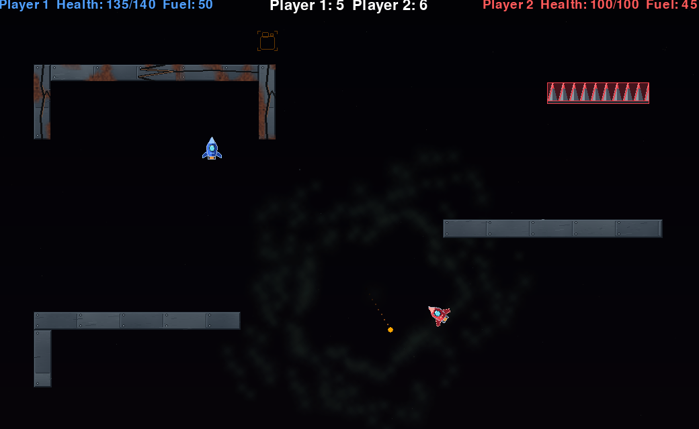

# Mayham

A local two-player rocket combat game built with Python and Pygame.

Players battle in a small arena using physics-based movement, projectiles, and limited fuel. The game is designed around fast rounds where aggressive movement and fuel management are essential.

## Gameplay

- Two-player local multiplayer
- Rocket movement with gravity and thrust
- Circular player hitboxes and obstacle collision detection
- Projectiles, health, and damage
- Limited fuel with randomly spawning fuel pickups
- Round-based gameplay with persistent scores

## Controls

| Action | Player 1 | Player 2 |
|---|---|---|
| Rotate left | Left Arrow | A |
| Rotate right | Right Arrow | D |
| Thrust | Up Arrow | W |
| Shoot | Right Shift | Space |

## Installation

Requires Python 3.13 and Pygame.

Create and activate a virtual environment:

`python3.13 -m venv .venv`

`source .venv/bin/activate`

Install Pygame:

`python -m pip install pygame`

Run the game:

`python main.py`

## Implementation

The game uses object-oriented Python, with shared player behavior, separate gameplay entities, and Pygame sprite groups.

Collision detection uses circular player hitboxes against rectangular obstacles. Physics, projectile handling, fuel management, and round logic are implemented in separate components.

## Tests

With Pygame installed, run the tests from the project root:

`python -m unittest discover -s tests -v`

Game setup tests use SDLs dummy drivers, so they do not open a game window.

## Authors

Developed by Irjan Evertsen and Emil Olsen-Kristiansen as a university project for INF-1400 at UiT – The Arctic University of Norway.